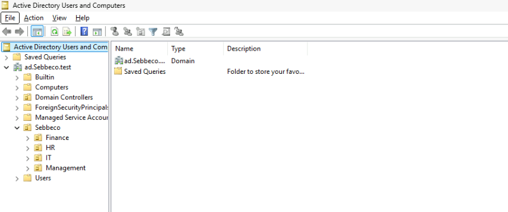
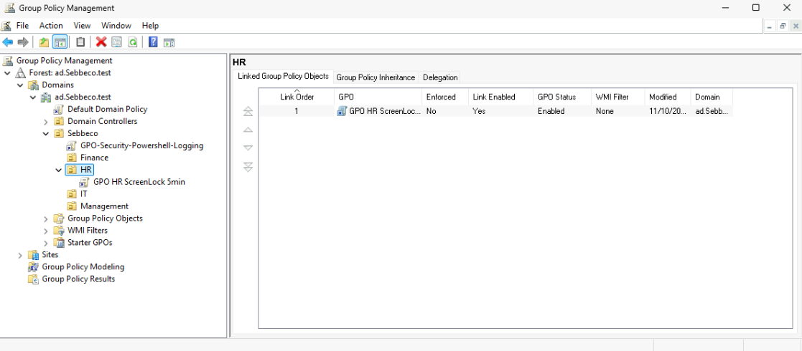
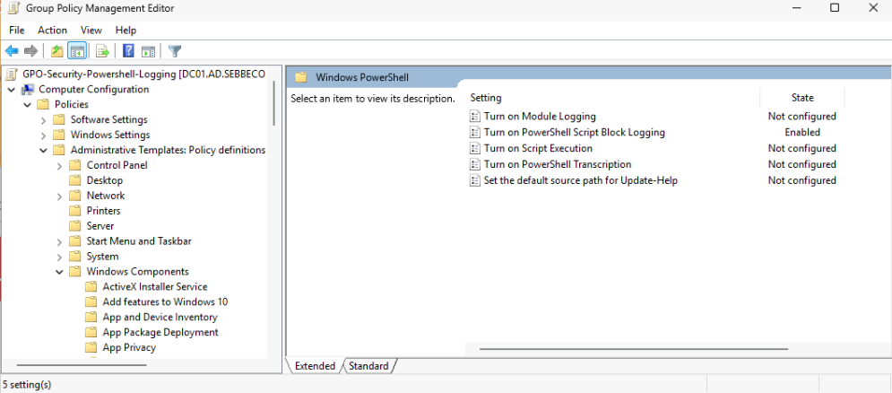

# Sebbeco Enterprise Home Lab

A virtual enterprise IT home lab focused on Windows and Linux administration, Active Directory, networking, remote access and cybersecurity monitoring using Wazuh SIEM.

## Overview

This project documents the design, implementation and administration of a virtual enterprise IT environment.

The lab simulates a small corporate network using VMware Workstation, Windows Server, Windows 11 and Ubuntu Server.

The project provides practical experience with enterprise infrastructure, centralized identity management, security policies, endpoint monitoring, SIEM operations and security event investigation.

The environment is continuously expanded with new configurations, detection capabilities and practical exercises.

## Lab Architecture

The lab consists of three virtual machines connected through an isolated VMware Host-only network.

| Component | Technology | Purpose |
|---|---|---|
| Hypervisor | VMware Workstation | Virtualization |
| Domain Controller | Windows Server 2025 | Active Directory and DNS |
| Client Workstation | Windows 11 Pro | Domain-connected workstation |
| SIEM Server | Ubuntu Server 24.04.5 LTS | Wazuh Manager, Indexer and Dashboard |
| Endpoint Monitoring | Sysmon | Windows endpoint telemetry |
| Remote Access | Tailscale | Remote access and subnet routing |

### Network Configuration

| Device | Hostname | IP Address |
|---|---|---|
| Domain Controller | DC01 | 192.168.10.10 |
| Client Workstation | CLIENT01 | 192.168.10.20 |
| SIEM Server | WAZUH01 | 192.168.10.30 |

- Network subnet: `192.168.10.0/24`
- Network type: VMware Host-only
- Active Directory domain: `ad.Sebbeco.test`

## Implemented Features

### 1. Infrastructure and Networking

- Created and configured virtual machines using VMware Workstation.
- Designed an isolated Host-only network.
- Configured static IP addresses.
- Configured network communication between virtual machines.
- Configured DNS resolution for the Active Directory domain.

Documentation:
- [Network Topology](01-%20infrastructure/network-topology.md)
- [Network Configuration](04-%20networking/network-configuration.md)
- [DNS Configuration](04-%20networking/dns-configuration.md)

### 2. Active Directory

- Installed and configured Active Directory Domain Services.
- Promoted Windows Server to a Domain Controller.
- Created the `ad.Sebbeco.test` domain.
- Configured DNS services.
- Created Organizational Units for IT, HR, Finance and Management.
- Created domain user accounts and security groups.
- Joined CLIENT01 to the domain.
- Verified domain authentication and the computer's secure channel.

### Active Directory Structure

The directory is organized into four departmental Organizational Units:
IT, HR, Finance and Management.

Documentation:
- [Domain Configuration](02-%20active-directory/domain-configuration.md)
- [Organizational Units](02-%20active-directory/organizational-units.md)
- [User and Group Management](02-%20active-directory/user-management.md)

### 3. Group Policy Management

- Created a department-specific Group Policy Object for HR.
- Configured screen saver activation after 300 seconds.
- Enabled password protection when resuming from the screen saver.
- Created a security GPO enabling PowerShell Script Block Logging.
- Verified policy application using `gpupdate` and `gpresult`.

### HR Group Policy Configuration

The screenshot shows the HR Organizational Unit with the `GPO-HR-ScreenLock-5min` Group Policy Object linked and enabled.

### PowerShell Script Block Logging GPO

The screenshot shows the Group Policy configuration enabling PowerShell Script Block Logging through Computer Configuration.

Documentation:
- [HR Screen Lock Policy](03-%20group-policy/hr-screen-lock.md)
- [PowerShell Script Block Logging](03-%20group-policy/powershell-script-block-logging.md)

### 4. Security Monitoring and SIEM

Deployed Wazuh as an all-in-one SIEM solution on Ubuntu Server.

Implemented:

- Wazuh Manager, Indexer and Dashboard.
- Wazuh agent installation and enrollment on CLIENT01.
- Sysmon integration for detailed Windows endpoint telemetry.
- Windows Security, System and Application event collection.
- PowerShell Operational event collection.
- Raw JSON event archiving.
- Centralized event investigation through Wazuh Discover.

### 5. Security Event Investigation

Collected and investigated Windows endpoint events, including:

| Event ID | Source | Description |
|---|---|---|
| 1 | Sysmon | Process creation |
| 3 | Sysmon | Network connection |
| 5 | Sysmon | Process termination |
| 11 | Sysmon | File creation |
| 4104 | PowerShell | Script Block Logging |

Practical exercises include:

- Investigating process execution and parent-child relationships.
- Analyzing PowerShell commands and script contents.
- Investigating endpoint network connections.
- Correlating process and network activity.
- Examining suspicious PowerShell execution patterns.

### 6. Custom Wazuh Detection Engineering

Developed and tested a custom Wazuh detection rule to identify PowerShell local group membership enumeration.

| Property | Value |
|---|---|
| Rule ID | `100100` |
| Severity | 5 |
| Event ID | `4104` |
| MITRE ATT&CK | `T1069.001` |
| Technique | Permission Groups Discovery: Local Groups |

The detection uses PowerShell Script Block Logging and matches the `Get-LocalGroupMember` cmdlet.

Testing included:

- A positive detection test using `Get-LocalGroupMember`.
- A false-positive test using the cmdlet as harmless text.
- Verification of the resulting alert in Wazuh Dashboard.

The detection was successfully triggered during the positive test, while the tested harmless text reference did not generate an alert.

See [Security Monitoring](05-%20security/security-monitoring.md) for the detection logic, testing details and screenshots.

### 7. Remote Access

Configured Tailscale subnet routing to allow remote access to the isolated lab network from a Linux Mint laptop.

Implemented and tested:

- Tailscale connectivity between the laptop and Windows desktop.
- Subnet routing to `192.168.10.0/24`.
- IPv4 forwarding on the Windows host.
- Remote Desktop access to DC01 and CLIENT01 using Remmina.
- SSH access to WAZUH01.
- Remote access to the Wazuh Dashboard over HTTPS.

Documentation:
- [Remote Access and Subnet Routing](04-%20networking/remote-access.md)

## Technologies and Tools

- VMware Workstation
- Windows Server 2025
- Windows 11 Pro
- Ubuntu Server 24.04.5 LTS
- Linux Mint
- Active Directory Domain Services
- DNS
- Group Policy Management
- PowerShell
- Sysmon
- Wazuh SIEM
- Tailscale
- Remmina
- SSH
- Git and GitHub

## Planned Development

The project is ongoing. Potential areas for further development include:

- Expand Windows Defender monitoring.
- Configure PowerShell Module Logging.
- Develop additional custom Wazuh detection rules.
- Investigate Windows authentication and account activity.
- Perform network discovery and service enumeration using Nmap.
- Expand SOC investigation and incident response exercises.

## Project Status

**Ongoing development.**

The core infrastructure, Active Directory environment, Group Policy configurations, centralized security monitoring and remote access setup are operational.

Wazuh successfully collects Sysmon and PowerShell events from CLIENT01. Custom detection rule `100100` has also been implemented and tested.

The repository documents the configurations, verification steps and practical exercises carried out during development.
